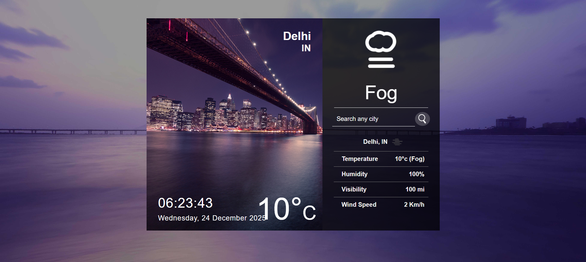

<div align="center">


# 🌤️ Weather App

### Real-time Weather Forecasting Application

[](https://app.netlify.com/projects/weather-forcasting-temperature/deploys)
[](https://reactjs.org/)
[](https://vite.dev/)
[](LICENSE)
</div>

---

## 🎯 About

A beautiful, responsive weather application built with **React** and powered by **Vite** that provides real-time weather information for any location worldwide. It leverages the **OpenWeatherMap API** and the browser's native **Geolocation API** to deliver an instant and accurate weather experience.

---

## 🚀 View Live Site

The project is fully deployed and accessible online.

[](https://weather-forcasting-temperature.netlify.app/)

---

## ✨ Features

- 🌍 **Geolocation Support**: Automatically detects your location for instant weather updates.
- 🔍 **Global City Search**: Search weather for any city worldwide using the integrated search bar.
- 🌡️ **Real-time Data**: Provides live temperature, humidity, visibility, and wind speed.
- 🎨 **Animated Icons**: Visual weather conditions are matched with beautiful Skycons animations.
- ⏰ **Live Clock**: Features a real-time ticking clock with current date display.
- 📱 **Responsive Design**: Fully optimized for mobile, tablet, and desktop views.
- ⚡ **Lightning Fast (Vite)**: Instant server start and sub-second production builds with 0 dependency vulnerabilities.

---

## 🛠️ Tech Stack & Rationale

### **Frontend & UI**

- **React.js**: Chosen for its component-based architecture, allowing for modular development.
- **Vite**: Modern front-end build tool that replaces legacy Create React App, providing instant HMR and optimized bundling.
- **HTML5 & CSS3**: Utilized for semantic structure and custom responsive styling.
- **JavaScript (ES6+)**: Handles the application logic, state, and asynchronous API interactions.

### **APIs & Data**

- **OpenWeatherMap API**: The primary data source providing comprehensive real-time atmospheric data.
- **Geolocation API (Native)**: Enables the "instant local weather" feature without user input.
- **Fetch & Axios**: Used for making reliable network requests to weather servers.

### **Components & Helpers**

- **react-animated-weather (with ESM Wrapper)**: Handles dynamic Skycons animations with a compatibility layer for modern bundlers.
- **Native React Clock (`Clock.jsx`)**: Lightweight, zero-dependency digital clock powered by React Hooks (`useState`, `useEffect`) and browser-native Date APIs.

---

## ⚙️ How It Works

1. **Detection**: On initial load, the app requests permission to access the user's location via the Geolocation API.
2. **API Call (Auto)**: If permission is granted, `currentLocation.jsx` fetches weather data for those specific coordinates.
3. **API Call (Search)**: Users can search for any city. `forcast.jsx` uses **Axios** to query the OpenWeatherMap API by city name.
4. **State Management**: React updates the application state with temperature, city name, and weather status (e.g., "Haze", "Rain").
5. **Dynamic UI**: The UI dynamically updates background images and animated icons to match the current conditions.

---

## 📁 Project Structure

```bash
Weather-App/
├── index.html              # Single page entry point (Vite root)
├── vite.config.js          # Vite configuration & plugins
├── public/                 # Static assets (favicons, robots.txt, manifest)
├── src/
│   ├── images/             # UI backgrounds and loading icons
│   ├── App.css             # Main styling & responsive layout
│   ├── App.jsx             # Main App layout component
│   ├── apiKeys.js          # Environment-based API config
│   ├── Clock.jsx           # Lightweight ticking digital clock
│   ├── currentLocation.jsx # Main dashboard & geolocation logic
│   ├── forcast.jsx         # Search functionality & forecast logic
│   ├── WeatherIcon.jsx     # ESM adapter for animated weather icons
│   ├── index.css           # Global typography & baseline styles
│   └── index.jsx           # React DOM root render
├── .env                    # 🔒 Private API keys (VITE_WEATHER_API_KEY)
├── .env.example            # Environment variables template
├── Project_Report.txt      # Detailed project documentation & college report
├── package.json            # Project dependencies & scripts
└── README.md               # Documentation
```

---

## 🚀 Installation & Setup

### 📥 1. Clone & Install

```bash
git clone https://github.com/ajaygangwar945/Weather-App.git
cd Weather-App
npm install
```

### 🔑 2. API Key Configuration

Create a `.env` file in the root directory (or copy `.env.example`):

```env
VITE_WEATHER_API_KEY=YOUR_OPENWEATHERMAP_API_KEY
```

*(Legacy `REACT_APP_WEATHER_API_KEY` is also supported for backwards compatibility).*

### 🏃 3. Run Locally

```bash
# Start development server (http://localhost:3000)
npm start
# or
npm run dev
```

### 📦 4. Build for Production

```bash
npm run build
```
The optimized production bundle will be generated in the `/dist` folder in under a second.

---

## 📸 Screenshots

<div align="center">
  
  <p><i>Home screen displaying real-time weather and animated icons</i></p>
</div>

---

## 🤝 Contributing

Contributions are welcome! Please feel free to submit a Pull Request.

1. Fork the Project
2. Create your Feature Branch (`git checkout -b feature/NewFeature`)
3. Commit your Changes (`git commit -m 'Add NewFeature'`)
4. Push to the Branch (`git push origin feature/NewFeature`)
5. Open a Pull Request

---

## 📝 License

This project is licensed under the MIT License.

---

<div align="center">

### ⭐ Star this repository if you found it helpful

Made with ❤️ by Ajay Gangwar

</div>
